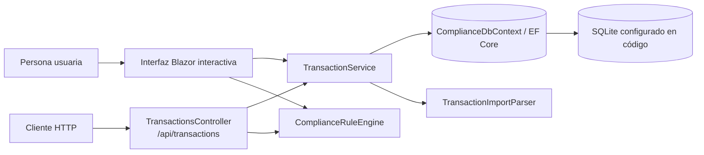
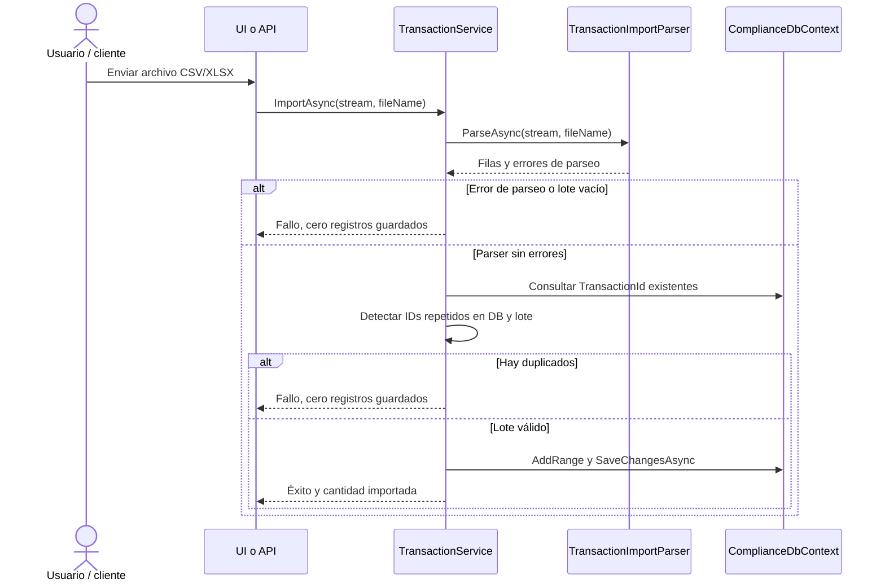
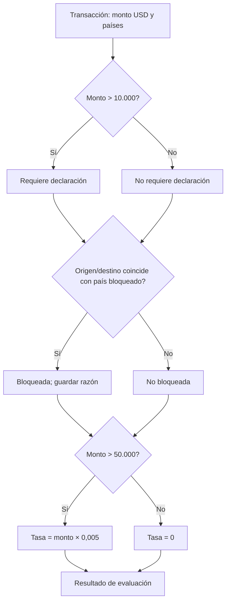

# 04 — Diagramas

Diagramas de comportamiento observado, no contratos de integración completos. Se escriben en Mermaid.

## Contexto

**[Pendiente]** README documenta SQL Server LocalDB en lugar de SQLite; el diagrama representa el proveedor configurado en `Program.cs`, no una decisión aprobada.

## Importación

## Evaluación de transacción

La evaluación devuelve un resultado; no afirmar que por sí sola persiste ni impide una transacción. Los efectos concretos dependen de su consumidor.
